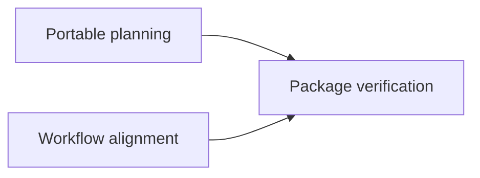

# Toolbox map

1. [F001 portable planning](functions/F001_portable_planning/SUBPLAN.md) produced the published reusable function plan generator and templates.
2. [F002 workflow alignment](functions/F002_workflow_alignment/SUBPLAN.md) connected the published project instructions, catalog, shared user rules and worker prompts to that planning capability.
3. [F003 verification](functions/F003_verification/SUBPLAN.md) completed scoped checks of the assembled outputs of F001 and F002; their payload publication is verified. Final shared record publication is coordinator owned.

Resume from [progress](PROGRESS.md) and the assigned subplan. Full parent context is needed only to resolve an actual missing requirement.
